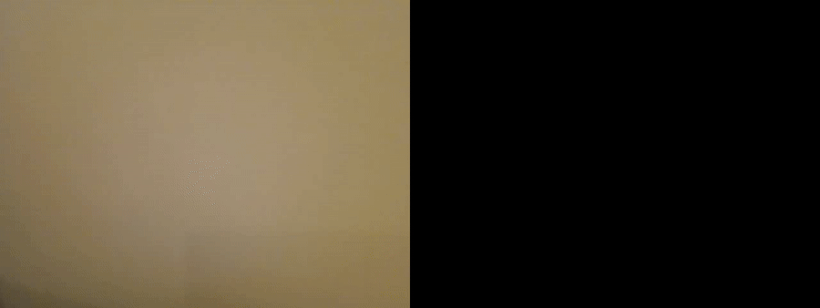

# arm-sorter

A 3D-printed 4-DOF robotic arm that sorts colored objects into bins, guided by a fixed overhead webcam.

> **Status:** step 1 of 5. Color-based object detection with OpenCV.



## How it will work

- A **USB webcam** mounted above the table streams to the laptop.
- The **laptop** does all the computation: it detects objects, converts pixel coordinates to table coordinates in cm, and solves the arm's inverse kinematics.
- An **ESP32** acts only as an interface: it receives joint angles over serial and drives the servos through a PCA9685 PWM driver.
- A **MuJoCo digital twin** is used to test motion before running it on the real arm.

## Roadmap

- [x] **Vision:** detect a colored object and find its centroid (HSV thresholding)
- [ ] **Calibration:** pixel → cm on the table plane using 4 ArUco markers and a homography
- [ ] **Kinematics:** analytic inverse kinematics (rotating base + 2-link planar arm + wrist keeping the gripper vertical)
- [ ] **Simulation:** arm model in MuJoCo, full pick-and-place in sim
- [ ] **Hardware:** printed arm (PLA-CF), servos, ESP32 firmware, real sorting demo
- [ ] **Learned detection:** replace color thresholds with a small YOLO model trained on my own objects

## Step 1: color detection

`tools/color_tuner.py` finds the largest object of a given color in the webcam feed and marks its centroid.

Each frame goes through this pipeline:

1. Gaussian blur to reduce sensor noise.
2. BGR → HSV conversion, because hue stays fairly stable between light and shadow.
3. `inRange` thresholding to get a binary mask.
4. Morphological opening (removes specks) then closing (fills holes).
5. Largest external contour, ignoring blobs under 500 px.
6. Centroid from image moments, which is more stable than the bounding-box center when the object is tilted or partly covered.

### Run it

Requires Python 3.12+.

```bash
pip install -e ".[dev]"
python tools/color_tuner.py      # optional: webcam index, e.g. 1
python -m pytest                 # tests run on synthetic images, no webcam needed
```

The detection logic lives in `src/arm_sorter/vision/color.py`; the script only handles the webcam and the sliders.

Three windows open:

- **webcam:** the camera feed. Click on the object to print its HSV values in the terminal.
- **maschera** (mask): what the algorithm sees. White means "matches the color".
- **controlli** (controls): sliders for the HSV thresholds.

Press `q` to quit.

### Tuning the thresholds

1. Open every range fully, then narrow **H** around the object's hue. OpenCV's hue goes from 0 to 179, not 0 to 360.
2. Raise **S min** until gray or white background areas disappear.
3. Raise **V min** to drop dark shadows.

Some colors need extra care:

- **Red** wraps around 0/179 and needs two ranges. This is not supported yet.
- **Orange** overlaps with skin tones, so blue or yellow objects are easier to start with.

### Known limitations

- Thresholds depend on lighting. The webcam's auto-exposure and auto white balance shift colors, which is the main reason a learned detector is on the roadmap.
- Only one object, the largest, is tracked at a time.

## Tech stack

Python · OpenCV · NumPy. Planned: MuJoCo, ESP32 (Arduino framework), PCA9685, YOLO.